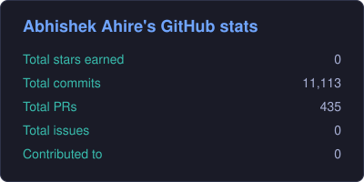
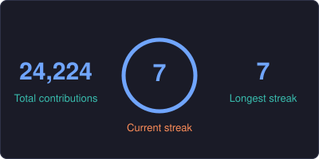
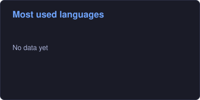

<p align="center">
  
</p>

<p align="center">
  
  
</p>

---

## 👨‍💻 About Me

```java
public class Abhishek {
    String role    = "Software Developer & Data Analytics Engineer";
    String stack   = "Java · Spring Boot · Python · SQL · Power BI";
    String focus   = "Backend Engineering · REST APIs · BI · ML";
    String funFact = "I turn messy datasets into real-time dashboards.";

    public void currentlyBuilding() {
        System.out.println("Supply chain OS, financial intelligence, backend systems");
    }
}
```

---

## 🛠 Tech Arsenal

<div align="center">

**⚙️ Backend**<br>


**📈 Data & ML**<br>


**🗄️ Databases**<br>


**🌐 Frontend & Tools**<br>


</div>

---

## 🚀 Featured Projects

<table>
  <tr>
    <td width="50%" valign="top">
      <h3>🚚 Supply Chain OS</h3>
      <p>Tracks carrier delays, warehouse inventory health and real-time shipment transit risk.</p>
      <code>Python</code> <code>Streamlit</code> <code>SQLite</code> <code>Plotly</code><br><br>
      <a href="https://supplyd.streamlit.app/">▶ Live Demo</a>
    </td>
    <td width="50%" valign="top">
      <h3>⚡ Churn & Revenue Intelligence</h3>
      <p>ML churn prediction, RFM segmentation and retention strategy engine.</p>
      <code>Python</code> <code>Scikit-learn</code> <code>Streamlit</code> <code>Plotly</code><br><br>
      <a href="https://intelligenceplatform.streamlit.app/">▶ Live Demo</a>
    </td>
  </tr>
  <tr>
    <td width="50%" valign="top">
      <h3>📊 N100 Financial Intelligence</h3>
      <p>Portfolio performance, market indices and risk metrics with real-time charts.</p>
      <code>Python</code> <code>Pandas</code> <code>Streamlit</code> <code>SQL</code><br><br>
      <a href="https://n100atech31.streamlit.app/">▶ Live Demo</a>
    </td>
    <td width="50%" valign="top">
      <h3>👥 HR Attrition Intelligence</h3>
      <p>Predictive people analytics for retention, demographics and turnover risk.</p>
      <code>Python</code> <code>Scikit-learn</code> <code>Streamlit</code> <code>Plotly</code><br><br>
      <a href="https://hrintelligence.streamlit.app/">▶ Live Demo</a>
    </td>
  </tr>
  <tr>
    <td width="50%" valign="top">
      <h3>🛡️ Risk & Fraud Intelligence Engine</h3>
      <p>Fraud detection simulation, anomaly analysis and risk scoring.</p>
      <code>Python</code> <code>Scikit-learn</code> <code>Streamlit</code> <code>SQL</code><br><br>
      <a href="https://enterprisefraud.streamlit.app/">▶ Live Demo</a>
    </td>
    <td width="50%" valign="top">
      <h3>📈 BlueStock Mutual Fund Suite</h3>
      <p>FinTech pipeline for NAV metrics, fund performance and AUM trends with Power BI.</p>
      <code>Python</code> <code>SQLite</code> <code>Power BI</code> <code>Jupyter</code><br><br>
      <a href="https://github.com/Atech31/bluestock-mutual-fund-dashboard-">View Repo</a>
    </td>
  </tr>
  <tr>
    <td colspan="2" valign="top">
      <h3>🏨 Hotel Reservation System</h3>
      <p>Room availability search, booking management and relational billing models.</p>
      <code>Java</code> <code>Spring Boot</code> <code>PostgreSQL</code> &nbsp;·&nbsp; <i>Repo link coming soon</i>
    </td>
  </tr>
</table>

---

## 📊 GitHub Analytics

<p align="center">
  
  
</p>

<p align="center">
  
</p>

---

## 📫 Let's Connect

<p align="center">
  <a href="https://atech31.github.io/portfolio/"></a>
  <a href="mailto:abhishekahire2001@gmail.com"></a>
  <a href="https://www.linkedin.com/in/abhishek-ahire-b03146236/"></a>
</p>

<p align="center">
  <i>"Code is like humor. When you have to explain it, it’s bad."</i>
</p>
